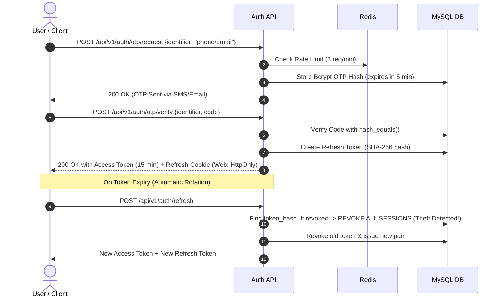
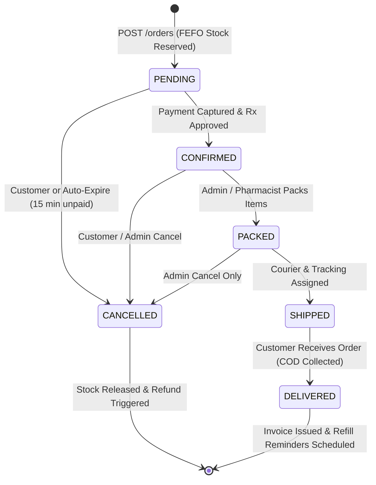
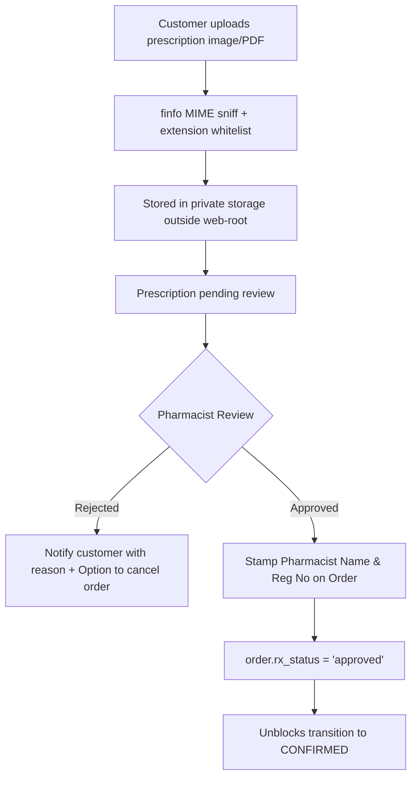
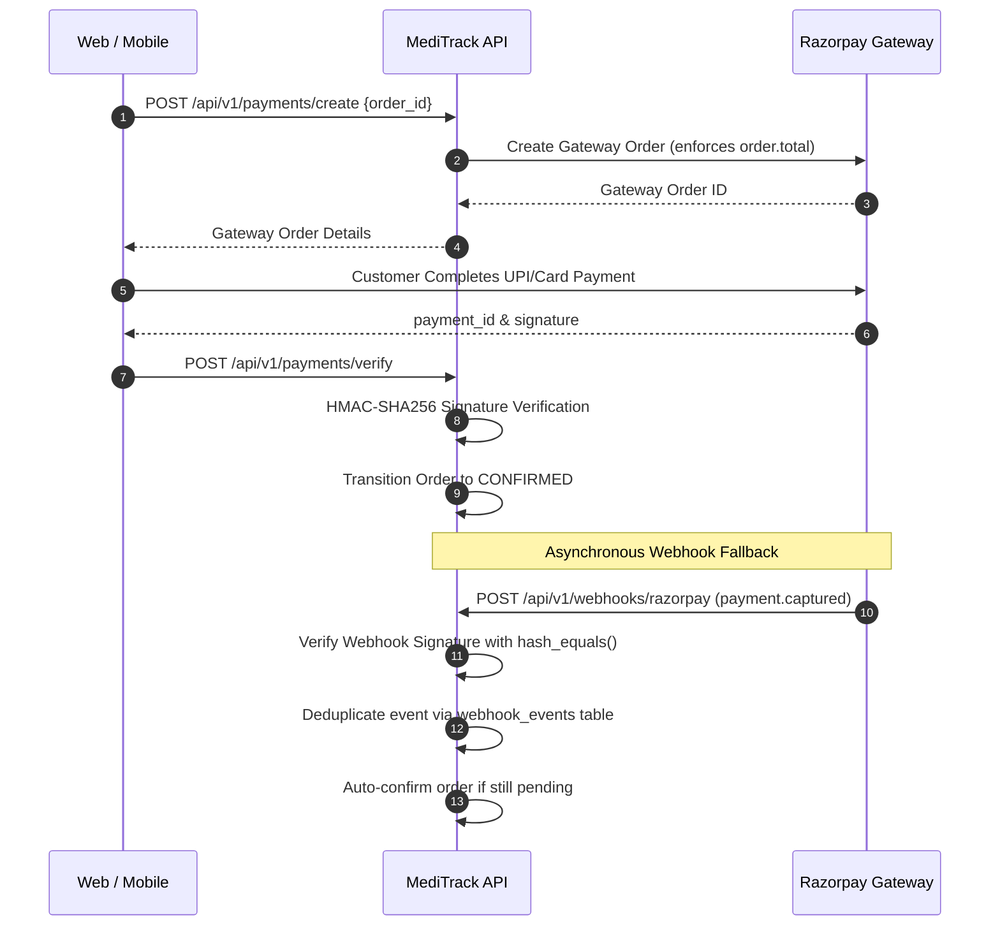
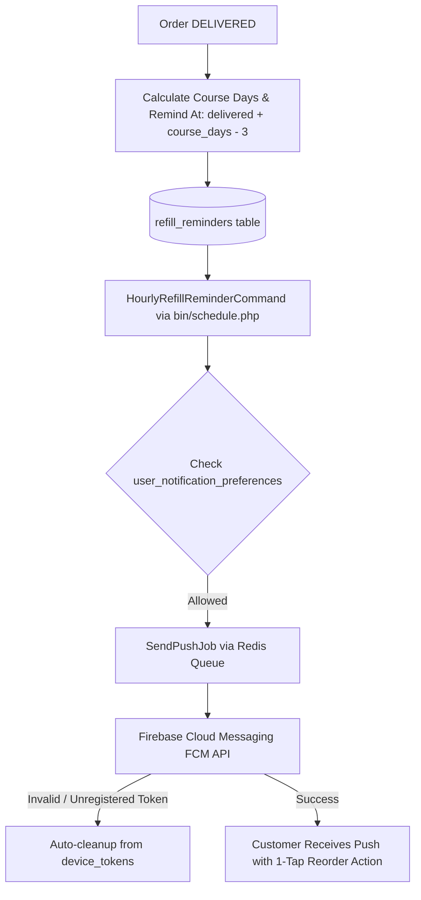

# MediTrack — Full-Stack Online Pharmacy & Inventory OS

<div align="center">


**A high-performance, framework-free Online Pharmacy Platform and Pharmacy Inventory Operating System built for compliance, scale, and lightning-fast customer experience.**

[](https://www.php.net/)
[](https://tailwindcss.com/)
[](https://www.mysql.com/)
[](https://redis.io/)
[](https://flutter.dev/)
[](#testing--verification)
[](#)

</div>

---

## 📋 Table of Contents
- [Project Overview](#-project-overview)
- [Architecture & Tech Stack](#-architecture--tech-stack)
- [Single Source of Brand Identity](#-single-source-of-brand-identity)
- [Core Workflows](#-core-workflows)
  - [1. Authentication & Session Rotation](#1-authentication--session-rotation)
  - [2. FEFO Inventory & Order Lifecycle](#2-fefo-inventory--order-lifecycle)
  - [3. Prescription Verification Workflow](#3-prescription-verification-workflow)
  - [4. Payment & Webhook Idempotency](#4-payment--webhook-idempotency)
  - [5. Concurrency-Safe GST Invoicing](#5-concurrency-safe-gst-invoicing)
  - [6. DPDP Act 2023 Customer Management](#6-dpdp-act-2023-customer-management)
  - [7. Push Notifications, Refill Reminders & Distributed Scheduler](#7-push-notifications-refill-reminders--distributed-scheduler)
- [Complete API Reference (`/api/v1`)](#-complete-api-reference-apiv1)
- [Directory Structure](#-directory-structure)
- [Getting Started & Local Setup](#-getting-started--local-setup)
- [Testing & Verification](#-testing--verification)
- [Customer Web Storefront Architecture (Phase 10)](#-customer-web-storefront-architecture-phase-10)
- [Admin Inventory OS & Pharmacy Management (Phase 11)](#-admin-inventory-os--pharmacy-management-phase-11)
- [License & Compliance Notice](#-license--compliance-notice)

---

## 🌟 Project Overview

**MediTrack** is an enterprise-grade, end-to-end pharmaceutical eCommerce and inventory management solution. It bridges customer medicine ordering with strict Indian Drugs & Cosmetics Act regulations, pharmacy inventory FEFO (First-Expiry-First-Out) fulfillment, automated GST compliance, and the Digital Personal Data Protection (DPDP) Act 2023.

### Key Highlights
- **Zero Monolithic Backend Frameworks**: Built using plain PHP 8.3 with a custom, high-speed PSR-4 mini-framework (`src/Core`), offering maximum execution speed, microscopic memory footprint, and complete control over security headers and SQL execution.
- **Strict Separation of Concerns**:
  - `frontend/`: Static HTML5 + Tailwind CSS + Vanilla ES Modules. Zero dynamic `innerHTML` (XSS-safe DOM builder).
  - `backend/`: Plain PHP 8.3 JSON REST API serving `/api/v1` endpoints with pure prepared PDO statements.
  - `mobile/`: Flutter (Dart) mobile application consuming the identical REST API with role-swapping (Customer vs Pharmacist mode).
- **Hardened Security & Privacy**: HttpOnly SameSite=Strict cookies for web refresh tokens, 15-minute JWT access tokens, automatic token theft & reuse detection, signed HMAC download URLs for medical records, and rate limiting with Redis Lua scripts.

---

## 🛠 Architecture & Tech Stack

```
┌────────────────────────────────────────────────────────────────────────┐
│                        MediTrack Ecosystem                             │
├─────────────────────────┬──────────────────────────────────────────────┤
│  Frontend (Web)         │ Static HTML5, Tailwind CSS, Vanilla JS       │
│  Mobile App             │ Flutter (Dart) — Customer & Owner Modes      │
│  API Gateway & Router   │ Nginx Reverse Proxy -> FastRoute (PHP 8.3)   │
│  Backend Services       │ Plain PHP 8.3 (MediTrack\Core Mini-Framework)│
│  Data Layer             │ MySQL 8.0 (InnoDB) + Redis (Cache, Queues)   │
│  Background Workers     │ Plain PHP CLI Worker & Scheduler             │
│  Third-Party Services   │ Razorpay (Payments), Msg91 (SMS), PHPMailer  │
└─────────────────────────┴──────────────────────────────────────────────┘
```

| Component | Technology | Description |
|---|---|---|
| **Backend Core** | PHP 8.3 | Custom micro-framework with DI Container, Router (`nikic/fast-route`), PDO Wrapper, QueryBuilder, and Validator |
| **Database** | MySQL 8.0 | Strict InnoDB, Foreign Keys, JSON columns, Full-Text indexing for medicines & composition salts |
| **Caching & Queues**| Redis 6/7 (`predis/predis`)| Versioned catalog cache, atomic Lua rate-limiting, and FIFO queues |
| **Authentication** | JWT (`firebase/php-jwt`) | 15-minute short-lived access tokens + 30-day rotating refresh tokens |
| **PDF Generation** | `dompdf/dompdf` | Server-side rendering of GST Tax Invoices in compliance with Indian pharmacy laws |
| **Payment Gateway** | Razorpay SDK | UPI, Debit/Credit Cards, Net Banking + COD gateway abstraction |
| **Frontend UI** | Modern Vanilla JS | Modular ES6, Tailwind CSS CLI, custom DOM helper `el()` preventing XSS, i18n (`en`/`hi`) |
| **Infra & DevOps** | Docker & Compose | Nginx, PHP-FPM 8.3, MySQL 8, Redis, Mailpit, CLI Worker, and Scheduler Cron |

---

## 🎨 Single Source of Brand Identity

All branding attributes (names, legal entities, phone numbers, emails, color palettes, logos) originate from a single JSON file:
[`brand/brand.json`](brand/brand.json)

Running the sync script propagates brand tokens across all platforms:
```bash
node brand/sync.mjs
```
- **Backend**: Generates [`backend/config/brand.php`](backend/config/brand.php) accessible via `brand('dot.key')`.
- **Frontend**: Generates [`frontend/tailwind.brand.cjs`](frontend/tailwind.brand.cjs) and injects favicons, logos, and metadata.
- **Mobile**: Generates Flutter launcher assets and `strings.xml`.

---

## 🔄 Core Workflows

### 1. Authentication & Session Rotation
MediTrack uses a passwordless Phone/Email OTP system with automated refresh token rotation and reuse detection.



---

### 2. FEFO Inventory & Order Lifecycle
Orders follow a strict First-Expiry-First-Out (FEFO) batch allocation algorithm.



---

### 3. Prescription Verification Workflow
Medicines marked `Schedule H/H1/X` mandate a registered pharmacist review before fulfillment.



---

### 4. Payment & Webhook Idempotency
Online orders integrate with Razorpay. Webhooks ensure eventual consistency even if customer network drops.



---

### 5. Concurrency-Safe GST Invoicing
When an order reaches `CONFIRMED`:
1. `GenerateInvoiceJob` executes via background queue.
2. An atomic counter row lock in `invoice_counters` assigns sequential invoice numbers: `INV-2026-000001`, `INV-2026-000002` without gaps or collisions under concurrent workers.
3. Dompdf renders [`templates/invoices/pdf.php`](backend/templates/invoices/pdf.php) with brand colors, shop GSTIN, drug license, pharmacist stamp, batch numbers, and CGST/SGST/IGST breakdown.
4. Saved in private storage `backend/storage/invoices/`. Customer downloads via `GET /orders/{id}/invoice`. Non-owners receive `403 Forbidden`.

---

### 6. DPDP Act 2023 Customer Management
- **Customer Lifetime Value (LTV)**: Real-time calculation summing all non-cancelled order totals.
- **Account Blocking**: Setting `is_blocked = 1` immediately terminates all active refresh tokens in `refresh_tokens`. Auth middleware rejects subsequent requests with `403 Forbidden` (`ACCOUNT_BLOCKED`).
- **Data Portability**: `GET /admin/customers/{id}/export` delivers a complete, portable JSON archive of user profile, saved addresses, orders, prescriptions, and refill logs.
- **Right to Erasure**: `POST /admin/customers/{id}/delete-request` tracks deletion requests with immutable audit logs.

---

### 7. Push Notifications, Refill Reminders & Distributed Scheduler
MediTrack integrates background push notifications, intelligent refill cycles, and automated cron tasks.



- **FCM Push Service**: Uses Firebase Cloud Messaging (`kreait/firebase-php`). Detects unregistered or defunct tokens (`NotFound`, `InvalidMessage`) and purges them automatically.
- **In-App Notifications**: Cursor-paginated notification inbox (`GET /api/v1/notifications`) supporting unread counts and batch mark-read.
- **Refill Reminders**: Delivers proactive refill alerts 3 days prior to running out (`remind_at = delivered + course_days - 3`), with 1-tap reorder that instantly loads medication into the active cart.
- **Distributed Scheduler**: `bin/schedule.php` uses Redis `SET NX` distributed mutex locks (`schedule:lock:{command}:{slot}`) with 5-minute to 24-hour TTLs to prevent double-runs across multiple server nodes.

---

## 📡 Complete API Reference (`/api/v1`)

### 🔑 Authentication & Profile
| Method | Endpoint | Description | Auth Required |
|---|---|---|---|
| `POST` | `/api/v1/auth/otp/request` | Request 6-digit OTP via SMS or Email | No (Rate-limited) |
| `POST` | `/api/v1/auth/otp/verify` | Verify OTP & receive JWT access + refresh tokens | No (Fail-closed) |
| `POST` | `/api/v1/auth/refresh` | Rotate refresh token & issue new access token | Cookie / Bearer |
| `POST` | `/api/v1/auth/logout` | Revoke current refresh token session | Bearer |
| `GET` | `/api/v1/auth/me` | Current authenticated user profile | Bearer |

### 🏬 Catalog & Search
| Method | Endpoint | Description | Auth Required |
|---|---|---|---|
| `GET` | `/api/v1/categories` | List active medicine categories | No |
| `GET` | `/api/v1/medicines` | Catalog with filters (category, rx, in_stock, price, sort) | No (Paginated) |
| `GET` | `/api/v1/medicines/{slug}` | Single medicine with earliest-expiring price & salts | No |
| `GET` | `/api/v1/search/suggest?q=` | Debounced live search suggestions (names & composition salts) | No (Cached 60s) |

### 🛒 Cart & Addresses
| Method | Endpoint | Description | Auth Required |
|---|---|---|---|
| `GET` | `/api/v1/cart` | Get current user's cart with subtotal & tax totals | Bearer |
| `POST` | `/api/v1/cart/items` | Add item to cart with live stock check | Bearer |
| `PUT` | `/api/v1/cart/items/{id}` | Update quantity of cart item | Bearer |
| `DELETE`| `/api/v1/cart/items/{id}` | Remove line item from cart | Bearer |
| `DELETE`| `/api/v1/cart` | Clear entire cart | Bearer |
| `GET` | `/api/v1/addresses` | List saved delivery addresses | Bearer |
| `POST` | `/api/v1/addresses` | Create delivery address | Bearer |
| `PUT` | `/api/v1/addresses/{id}` | Update delivery address | Bearer |
| `DELETE`| `/api/v1/addresses/{id}` | Remove delivery address | Bearer |

### 📦 Orders & Invoicing
| Method | Endpoint | Description | Auth Required |
|---|---|---|---|
| `POST` | `/api/v1/orders` | Checkout cart to order (Idempotency-Key enforced) | Bearer |
| `GET` | `/api/v1/orders` | Customer orders history (Cursor-based pagination) | Bearer |
| `GET` | `/api/v1/orders/{id}` | Detailed order status, timeline & item batches | Bearer (Owner Only) |
| `POST` | `/api/v1/orders/{id}/cancel` | Cancel order before packing (Restores stock) | Bearer (Owner Only) |
| `POST` | `/api/v1/orders/{id}/reorder` | Fast re-order items back into cart | Bearer (Owner Only) |
| `GET` | `/api/v1/orders/{id}/invoice` | Stream or download Dompdf GST Tax Invoice (PDF) | Bearer (Owner Only) |

### 📄 Prescriptions (Rx)
| Method | Endpoint | Description | Auth Required |
|---|---|---|---|
| `POST` | `/api/v1/prescriptions` | Multipart upload (JPG, PNG, PDF ≤ 5 MB, max 5 files) | Bearer |
| `GET` | `/api/v1/prescriptions` | List user's uploaded prescriptions | Bearer |
| `GET` | `/api/v1/prescriptions/reusable` | Fetch active reusable approved prescriptions | Bearer |
| `GET` | `/api/v1/prescriptions/{id}` | Prescription review status & metadata | Bearer (Owner Only) |
| `GET` | `/api/v1/prescriptions/{id}/files/{fId}`| HMAC signed short-lived (5 min) file streaming | Bearer (Owner Only) |

### 💳 Payments & Webhooks
| Method | Endpoint | Description | Auth Required |
|---|---|---|---|
| `POST` | `/api/v1/payments/create` | Initialize Razorpay gateway order | Bearer |
| `POST` | `/api/v1/payments/verify` | Verify payment signature & capture order | Bearer |
| `POST` | `/api/v1/webhooks/razorpay` | Razorpay webhook (Signature validated with secret) | Webhook Signature |

### 🔔 Notifications & Device Tokens
| Method | Endpoint | Description | Auth Required |
|---|---|---|---|
| `POST` | `/api/v1/devices` | Register FCM push device token (with platform & device info) | Bearer |
| `DELETE`| `/api/v1/devices/{token}` | Unregister specific device token on logout | Bearer |
| `DELETE`| `/api/v1/devices` | Unregister all device tokens for user | Bearer |
| `GET` | `/api/v1/notifications` | In-app notification inbox (Cursor-based pagination) | Bearer |
| `POST` | `/api/v1/notifications/read` | Mark single notification (`notification_id`) or all read | Bearer |
| `GET` | `/api/v1/notifications/preferences` | Retrieve user notification preferences | Bearer |
| `PUT` | `/api/v1/notifications/preferences` | Update push preferences (orders, refills, promo, stock)| Bearer |

### 💊 Refill Reminders
| Method | Endpoint | Description | Auth Required |
|---|---|---|---|
| `GET` | `/api/v1/refills` | List active medicine refill reminders with pricing & batch data | Bearer |
| `POST` | `/api/v1/refills/{id}/snooze` | Snooze reminder by specified days (e.g. 7 days) | Bearer (Owner Only) |
| `POST` | `/api/v1/refills/{id}/dismiss`| Dismiss refill reminder | Bearer (Owner Only) |
| `POST` | `/api/v1/refills/{id}/reorder` | 1-Tap reorder: adds prescribed item into active cart | Bearer (Owner Only) |

### ⏰ Background Scheduler Commands (`bin/schedule.php`)
Managed via cron or process manager with Redis `SET NX` distributed concurrency locks:
| Frequency | Command | Description |
|---|---|---|
| Every 5 min | `ExpireUnpaidOrdersCommand` | Auto-cancels unpaid Razorpay orders > 15 min and restores FEFO stock |
| Hourly | `HourlyRefillReminderCommand` | Scans due refill reminders and queues push notifications |
| Daily 08:00 | `DailyExpiryAlertCommand` | Scans batches expiring in ≤30 days and notifies pharmacists/admins |
| Nightly 22:00 | `NightlyLowStockDigestCommand` | Generates consolidated low-stock alert digest for pharmacy owners |

### 🛡 Admin Operations & DPDP
| Method | Endpoint | Description | Required Role |
|---|---|---|---|
| `GET` | `/api/v1/admin/dashboard/stats` | 6 Stat cards, expiry breakdown, revenue, alerts | Admin, Pharmacist |
| `GET` | `/api/v1/admin/medicines` | Full inventory table with server-side pagination | Admin, Pharmacist |
| `POST` | `/api/v1/admin/medicines` | Add new medicine with salts & category | Admin, Pharmacist |
| `GET` | `/api/v1/admin/expiring` | Medicines expiring within 30 or 90 days | Admin, Pharmacist |
| `GET` | `/api/v1/admin/expired` | Expired batches for return or disposal | Admin, Pharmacist |
| `GET` | `/api/v1/admin/low-stock` | Medicines below minimum reorder threshold | Admin, Pharmacist |
| `GET` | `/api/v1/admin/racks` | Racks and shelves management | Admin, Pharmacist |
| `GET` | `/api/v1/admin/orders` | Filter orders by status, payment, date range | Admin, Pharmacist |
| `PATCH` | `/api/v1/admin/orders/{id}/status` | Transition order status, assign courier tracking | Admin, Pharmacist |
| `GET` | `/api/v1/admin/prescriptions` | Review queue of pending customer prescriptions | Admin, Pharmacist |
| `PATCH` | `/api/v1/admin/prescriptions/{id}/review` | Approve/Reject prescription & stamp pharmacist reg # | Admin, Pharmacist |
| `GET` | `/api/v1/admin/invoices` | List and search all generated GST invoices | Admin, Pharmacist |
| `POST` | `/api/v1/admin/invoices/{id}/resend`| Resend invoice download notification to customer | Admin, Pharmacist |
| `GET` | `/api/v1/admin/customers` | Customer list with orders count & lifetime value (LTV)| Admin |
| `GET` | `/api/v1/admin/customers/{id}` | Detailed customer profile with address & order log | Admin |
| `POST` | `/api/v1/admin/customers/{id}/block` | Block customer & immediately revoke all sessions | Admin |
| `POST` | `/api/v1/admin/customers/{id}/unblock` | Restore customer access | Admin |
| `GET` | `/api/v1/admin/customers/{id}/export` | DPDP Act 2023 portable personal data JSON export | Admin |
| `POST` | `/api/v1/admin/customers/{id}/delete-request` | Record DPDP Right to Erasure account deletion | Admin |

---

## 📂 Directory Structure

```
meditrack/
├── backend/                       # Plain PHP 8.3 JSON REST API (No framework)
│   ├── bin/                       # CLI commands: worker, scheduler, migrate, seed
│   ├── bootstrap/                 # Application bootstrap & DI Container setup
│   ├── config/                    # Database, Redis, CORS, JWT, rate limits config
│   ├── database/                  # Schema definition and incremental migrations
│   ├── lang/                      # Bilingual error and notification messages (en, hi)
│   ├── public/                    # Front controller (index.php) - Single web entry point
│   ├── src/                       # PSR-4 Autoloaded source code (MediTrack\)
│   │   ├── Controllers/           # Storefront and Admin API Controllers
│   │   ├── Core/                  # Mini-framework: Router, DB, Cache, Queue, Validator
│   │   ├── Enums/                 # PHP 8.1+ backed Enums (Role, OrderStatus, etc.)
│   │   ├── Jobs/                  # Asynchronous queue jobs (Invoice, Email, SMS)
│   │   ├── Middleware/            # Pipeline: Auth, Role, ForceJson, RateLimit, CORS
│   │   ├── Policies/              # Authorization & IDOR protection policies
│   │   ├── Repositories/          # 100% prepared PDO SQL database repositories
│   │   └── Services/              # Business logic: Order, FEFO Stock, Payment, Invoice
│   ├── storage/                   # Private storage (invoices, prescriptions, logs, backups)
│   ├── templates/                 # Dompdf invoice and email templates
│   └── tests/                     # PHPUnit Feature and Unit test suites
├── brand/                         # Single source of truth for branding
│   ├── assets/                    # SVG logos, dark variants, favicons, app icons
│   ├── brand.json                 # Core brand tokens (colors, names, contact, legal)
│   └── sync.mjs                   # Cross-platform token synchronization script
├── frontend/                      # Static Web Storefront & Admin Portal
│   ├── src/                       # Source HTML templates, partials, and Tailwind CSS
│   ├── src/js/                    # Modular Vanilla JavaScript (Auth, API wrapper, DOM)
│   ├── dist/                      # Production-ready compiled static files
│   ├── build.mjs                  # Static site builder and template compiler
│   └── package.json               # Node dependencies (Tailwind CLI, Playwright)
├── infra/                         # Production infrastructure configuration
│   └── nginx/                     # Reverse proxy routing /api -> backend, / -> frontend
├── mobile/                        # Cross-Platform Flutter Client (Dart)
└── docker-compose.yml             # Full containerized development environment
```

---

## 🚀 Getting Started & Local Setup

### Prerequisites
- **PHP 8.3+** with extensions: `pdo_mysql`, `pdo_sqlite`, `redis`, `gd`, `mbstring`, `fileinfo`, `curl`
- **Composer** (PHP package manager)
- **Node.js 18+** & npm
- **MySQL 8.0+**
- **Redis 6+**
- *(Optional)* **Docker & Docker Compose**

---

### Step-by-Step Installation

#### 1. Clone the Repository
```bash
git clone https://github.com/Rajkumar1813/meditrack.git
cd meditrack
```

#### 2. Configure Environment Variables
```bash
cp .env.example backend/.env
```
Edit `backend/.env` with your database and service credentials:
```ini
APP_ENV=development
APP_DEBUG=true
APP_KEY=base64:your-32-byte-secret-key-goes-here!

DB_CONNECTION=mysql
DB_HOST=127.0.0.1
DB_PORT=3306
DB_DATABASE=meditrack
DB_USERNAME=root
DB_PASSWORD=

REDIS_HOST=127.0.0.1
REDIS_PORT=6379

RAZORPAY_KEY_ID=rzp_test_samplekey
RAZORPAY_KEY_SECRET=sample_secret_key
```

#### 3. Install Backend Dependencies & Run Migrations
```bash
cd backend
composer install

# Run database migrations & seed initial pharmacy catalog
php bin/migrate.php
php bin/seed.php
cd ..
```

#### 4. Sync Brand Tokens & Build Frontend
```bash
# Sync brand.json into backend, frontend, and mobile
node brand/sync.mjs

# Install frontend dependencies and compile static assets
cd frontend
npm install
npm run build
cd ..
```

#### 5. Start Background Workers & Local Server
```bash
# Terminal 1: Background Queue Worker (for Invoices & Notifications)
php backend/bin/worker.php

# Terminal 2: Static Frontend Dev Server (Proxies /api to backend)
cd frontend
npm run dev
```

---

### Running via Docker Compose
To launch the complete containerized stack (Nginx, PHP-FPM 8.3, MySQL 8, Redis, Mailpit, Queue Worker, and Scheduler):
```bash
docker compose up -d
```
- Web Storefront: [http://localhost](http://localhost)
- Backend API: [http://localhost/api/v1](http://localhost/api/v1)
- Mailpit UI (Email testing): [http://localhost:8025](http://localhost:8025)

---

## 🧪 Testing & Verification

The project includes exhaustive automated test suites covering Unit, Integration, Feature, and Security scenarios.

### Backend PHPUnit Tests
Runs all 188 tests against an in-memory SQLite isolated environment:
```bash
cd backend
./vendor/bin/phpunit
```
```
Tests: 188, Assertions: 823, Failures: 0, Errors: 0
```

### Frontend Unit Tests
Executes native Node.js unit tests for API error normalization, token refresh retry loops, safe DOM rendering, and i18n switching:
```bash
cd frontend
npm run test:unit
```
```
✔ API Core Fetch Wrapper (envelope parse, refresh retry, 429 backoff)
✔ Brand Core Module (token reading, dynamic themes)
✔ DOM Core Helpers (XSS-safe text nodes, zero innerHTML)
✔ i18n Core Module (bilingual en/hi switching)
ℹ tests 13 | pass 13 | fail 0
```

### Frontend End-to-End Tests (Playwright)
Validates complete user journeys, security invariants, accessibility, and visual micro-interactions:
```bash
cd frontend
npm run test:e2e
```
```
  ok  1 role-based menu: pharmacist has restricted settings, admin has full access (2.8s)
  ok  2 dashboard visual parity: 6 stat cards, inline SVG donut and bar charts (2.3s)
  ok  3 complete pharmacy workflow: add medicine -> expiring -> order fulfillment (pending to shipped) (15.2s)
  ok  4 complete flow: login -> search -> cart -> COD checkout -> order detail page (3.7s)
  ok  5 XSS immunity: medicine with <script> tag renders as safe text, never executes (1.2s)
  ok  6 3D perspective card tilt honors prefers-reduced-motion (1.0s)
  ok  7 mode toggle switches between mobile number and email (1.2s)
  ok  8 validates invalid mobile number with error message (984ms)
  ok  9 complete OTP request and admin login redirect flow (2.3s)
  ok 10 customer role redirects to store homepage (2.2s)
  ok 11 rate limit 429 shows countdown banner and disables buttons (1.2s)
  ok 12 home page renders brand name, header, and categories (1.2s)
  ok 13 theme toggle switches dark mode class on html element (1.2s)
  ok 14 language toggle switches locale and updates labels (1.3s)
  ok 15 login page displays OTP request form with 3D card layout (922ms)
  ok 16 admin page redirects unauthenticated users to login (1.2s)

  16 passed (100% clean across storefront & admin)
```

---

## 🛍 Customer Web Storefront Architecture (Phase 10)

The storefront is crafted in `frontend/src/` with a zero-framework architecture designed for instantaneous loads, micro-animations, and complete compliance:

- **11 Dedicated Pages**:
  - `index.html`: Hero with floating 3D CSS/SVG capsule & tablet illustrations, dosage categories, and active refill reminder teaser.
  - `catalog.html`: Real-time filtering (categories, prescription requirement, in-stock only, price range), sort order, and grid/list view toggle.
  - `medicine.html`: Earliest-expiring batch FEFO pricing, full salt composition breakdown, Rx badge, quantity stepper, and therapeutic generic alternatives.
  - `cart.html`: Real-time stock reservation check, batch details, subtotal + GST calculation, Rx warning alert banner.
  - `checkout.html`: Saved delivery address selection + inline address creator, payment mode (Razorpay Checkout JS + Cash on Delivery), and `Idempotency-Key` protected order placement.
  - `orders.html`: Order history cards with cursor-based pagination and status badges.
  - `order.html`: Visual fulfillment stepper timeline (Pending → Confirmed → Packed → Shipped → Delivered / Cancelled), tracking information, address snapshot, Dompdf GST tax invoice download, and 1-tap reorder.
  - `upload-rx.html`: Drag-and-drop prescription uploader (JPG/PNG/PDF ≤5MB, up to 5 files) with review history and signed HMAC view links.
  - `profile.html`: Customer details, saved addresses CRUD (add/edit/delete/default), push notification preferences, active refills management, and DPDP Act 2023 data export/erasure portal.
  - `notifications.html`: In-app notification inbox, unread counts, and deep-link routing.
  - `login.html`: 3D tilt authentication card with phone/email OTP, 60s cooldown timer, and role-based redirects.
- **Micro-Interactions & 3D Polish**:
  - CSS perspective card tilt (`js/ui/tilt-3d.js`) honoring `prefers-reduced-motion`.
  - Debounced auto-suggest search (`js/ui/search-suggest.js`) with medicine & salt grouping, safe text highlighting, and `AbortController` cancellation.
  - Zero dynamic `innerHTML`: 100% of DOM nodes are rendered safely using text and element builders (`el()`, `text()`, `append()`, `setText()`), eliminating XSS vulnerabilities.
  - Bilingual English/Hindi toggle with dynamic dictionary loading.

---

## 🏥 Admin Inventory OS & Pharmacy Management (Phase 11)

The pharmacy back-office operating system is implemented under `frontend/src/admin/` and powered by ES6 store modules in `frontend/src/js/admin/`. It provides full layout, workflow, and visual parity with the reference design (`reference/Meditrack.html`) using our unified Emerald brand tokens:

- **10 Dedicated Operating Screens**:
  1. **Dashboard (`admin/index.html` & `js/admin/dashboard.js`)**:
     - 6 primary stat cards (Total medicines, Total units in stock, Low stock count, Expiring in 30 days, Expired units, and Total stock valuation based on `purchase_price * qty`).
     - Orders Today count + Today's Revenue counter.
     - Inline SVG Category Donut chart and Expiry Distribution bar chart (`js/ui/charts.js`, zero external chart library overhead).
     - Live critical alerts feed and recently added inventory table.
  2. **Medicines Management (`admin/medicines.html` & `js/admin/medicines.js`)**:
     - Responsive Table and Card layout switchers with search text highlighting.
     - Server-side pagination with "Showing X to Y of Z items" indicators.
     - Medicine Add/Edit modal with comprehensive field validations (brand/generic names, category, prescription flags, GST rates) and server validation error mapping.
     - Slide-over Batch Drawer: view active batches per medicine, add new batches (batch number, expiry > mfg date validation, MRP ≥ purchase price checks), and assign rack/shelf locations.
     - Direct CSV inventory export and 2-step CSV import modal (file upload → per-row preview validation report with error flags → background queue commit).
     - Clean print stylesheet (`@media print`) for offline physical stock audits.
  3. **Expiring Soon (`admin/expiring.html` & `js/admin/expiring.js`)**:
     - 30-day and 90-day expiry threshold filtering tabs.
     - Urgent batch cards displaying days remaining, FEFO rank, and action buttons (promotional discount, vendor return, hazardous disposal).
  4. **Expired Batches (`admin/expired.html` & `js/admin/expired.js`)**:
     - Expired stock ledger with calculated dead stock loss value.
     - Direct return-to-distributor and safe biomedical disposal logging.
  5. **Racks & Locations (`admin/racks.html` & `js/admin/racks.js`)**:
     - Physical warehouse & dispensary rack organizer with shelf listings.
     - Slide-over drawer displaying all medicines and batches physically located on each rack.
  6. **Orders Fulfillment Center (`admin/orders.html` & `js/admin/orders.js`)**:
     - Real-time order pipeline with status filtering (All, Pending, Confirmed, Packed, Shipped, Delivered, Cancelled).
     - Slide-over order inspector with customer address snapshot, ordered batches, payment details, and complete status timeline.
     - Status transition modal enforcing valid state transitions with courier selection, tracking number, and customer notes.
  7. **Prescription Verification Queue (`admin/prescriptions.html` & `js/admin/prescriptions.js`)**:
     - Review queue for customer-uploaded doctor prescriptions.
     - Interactive Prescription Viewer: zoom in/out, 90° clockwise rotation, pan, and reset on high-res HMAC signed URLs.
     - Digital clinical sign-off: Approve with validity period (`valid_until`) and registered pharmacist license number stamp, or Reject with mandatory reason code.
  8. **Customer Management & DPDP (`admin/customers.html` & `js/admin/customers.js`)**:
     - Customer directory displaying total orders and Lifetime Value (LTV).
     - Customer profile drawer with order history and saved delivery addresses.
     - Instant account suspension / unblocking with real-time JWT revocation.
     - DPDP Act 2023 portable personal data JSON export.
  9. **GST Tax Invoices (`admin/invoices.html` & `js/admin/invoices.js`)**:
     - Complete archive of gap-free sequenced tax invoices (`INV-YYYY-XXXXXX`).
     - Search by invoice ID, order number, or customer phone/name.
     - Direct Dompdf PDF download and SMS/email invoice link resend triggers.
  10. **Store Settings & Backup (`admin/settings.html` & `js/admin/settings.js`)**:
      - Restricted strictly to `admin` role.
      - Pharmacy profile: Shop name, legal entity, owner details, GSTIN, Drug License number, and Pharmacist registration.
      - Operational thresholds: Low stock threshold, base delivery fee, free delivery order minimum.
      - On-demand database backup: triggers server-side `mysqldump` and produces a secure, signed download URL.
- **Role-Based Access Control (RBAC)**:
  - Allowed roles: `admin`, `pharmacist`, `staff`.
  - Strict UI privilege gating: elements and sidebar links marked with `data-role-required="admin"` (e.g. Master Settings, Customer blocking, System backups) are hidden for non-admin staff, and route guards redirect unauthorized role attempts to `/admin/index.html`.
- **Absolute XSS Immunity**:
  - Exactly 0 usages of `.innerHTML =` across all admin JavaScript code. All tables, cards, badges, and modals are built purely via safe DOM constructors (`el`, `setText`, `append`).

---

## 📄 License & Compliance Notice

This software is developed for licensed retail pharmacy operations. Dispensing of Schedule H, H1, and X medications requires verification by a registered pharmacist under the **Drugs and Cosmetics Act, 1940** and **Pharmacy Practice Regulations**. Customer personal and medical data handling adheres to the **Digital Personal Data Protection (DPDP) Act, 2023**.
