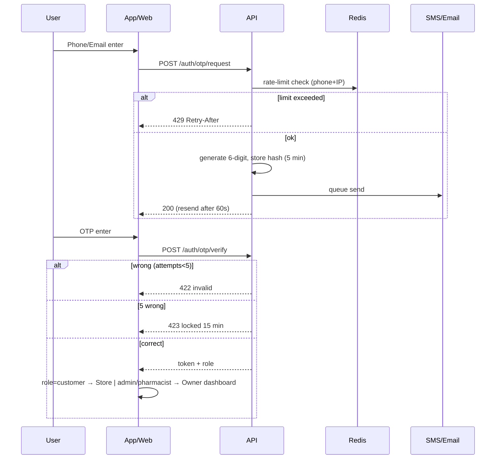
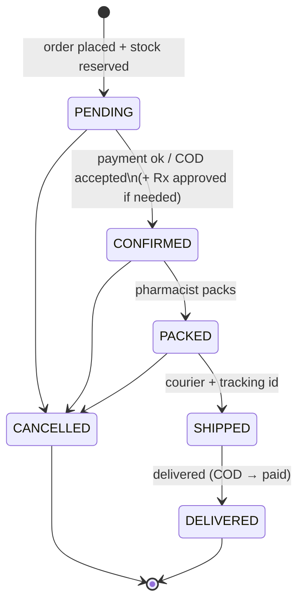
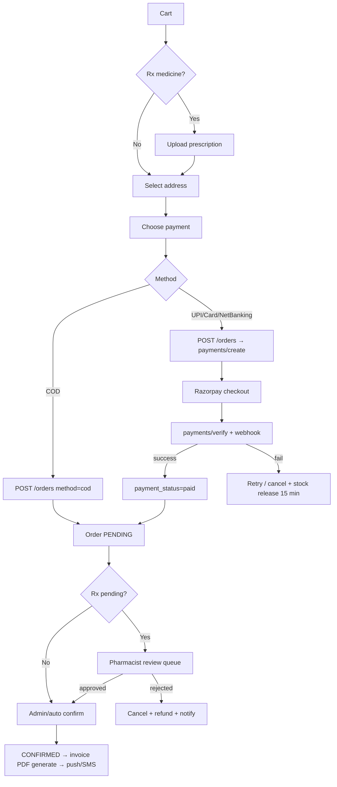
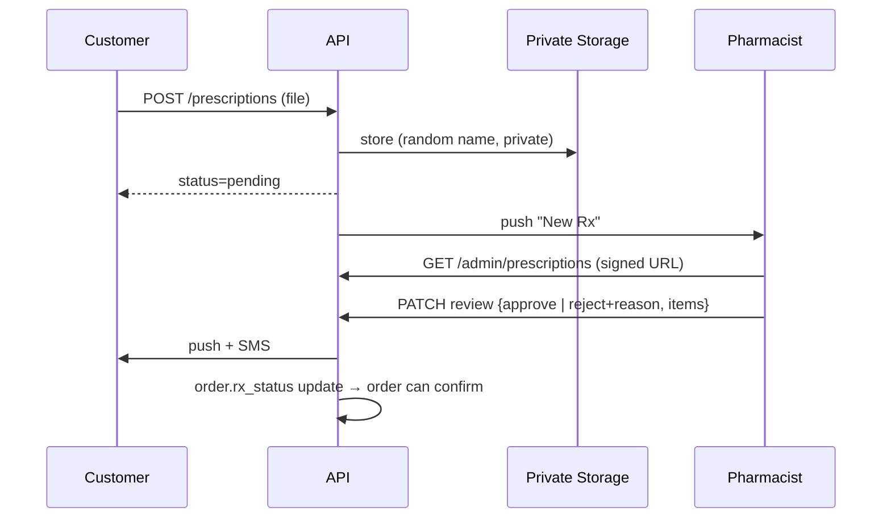
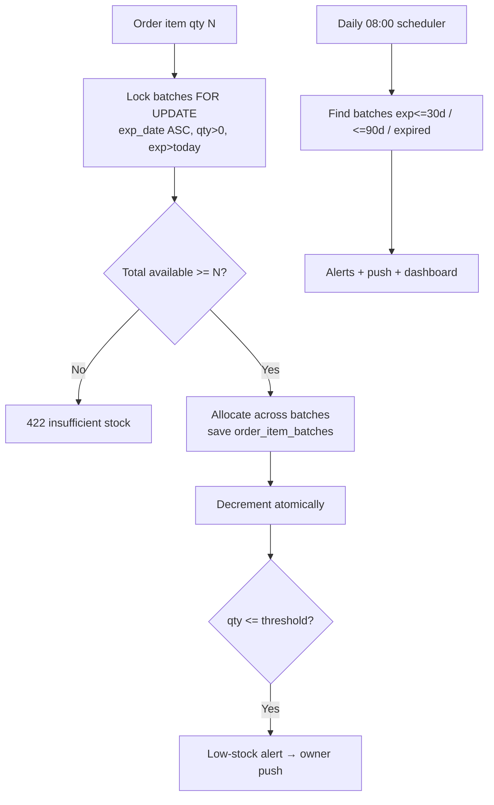
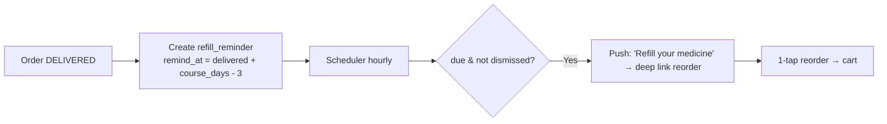
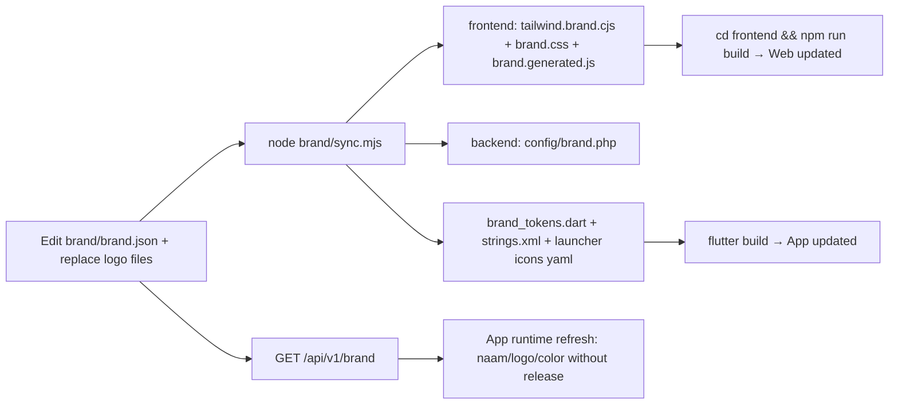

# 03 — Workflow Diagrams (Mermaid)

> GitHub, VS Code (Mermaid plugin), Antigravity preview — sab me render hote hain.

## 1. System architecture
```mermaid
flowchart LR
  subgraph Clients
    W[frontend/ Customer Web\nHTML + Tailwind + JS]
    A[frontend/ Admin Web\nHTML + Tailwind + JS]
    M[mobile/ Flutter App\nCustomer + Owner mode]
  end
  CDN[(CDN / Object Storage)]
  LB[Load Balancer / Nginx]
  subgraph Backend[Plain PHP API - stateless x N]
    API[REST /api/v1]
    Q[Queue Workers]
    S[Scheduler]
  end
  DB[(MySQL Primary)]
  RR[(MySQL Read Replica)]
  R[(Redis: cache, queue, rate-limit)]
  PG[Razorpay]
  SMS[MSG91 SMS]
  FCM[Firebase FCM]
  W & A & M --> LB --> API
  W & A & M -.images/rx.-> CDN
  API --> DB
  API --> RR
  API --> R
  API --> Q
  Q --> SMS & FCM
  API <--> PG
  PG -- webhook --> API
  S --> Q
  BR[brand/brand.json] -. sync.mjs .-> W & A & M
```

## 2. OTP login


## 3. Order lifecycle


## 4. Checkout + payment


## 5. Prescription verification


## 6. Stock (FEFO) + expiry alerts


## 7. Refill reminder


## 8. Brand change flow

